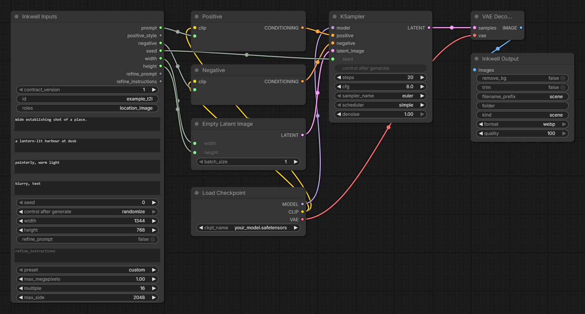
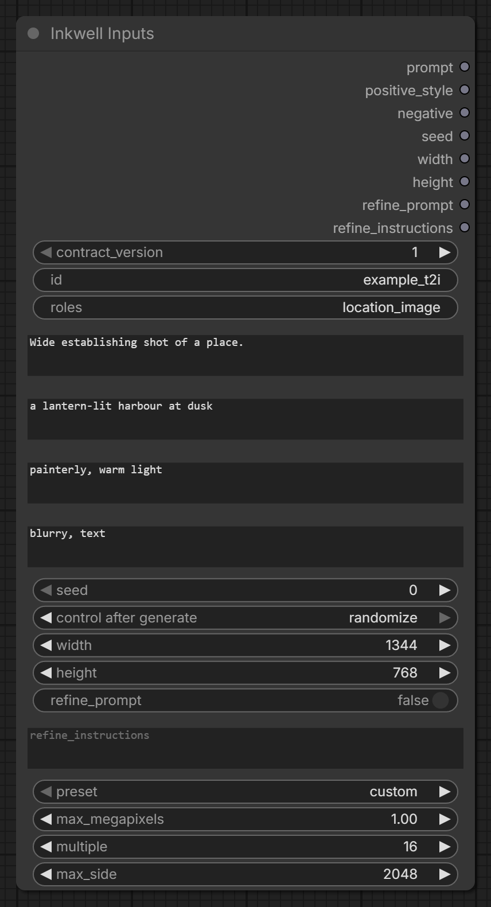
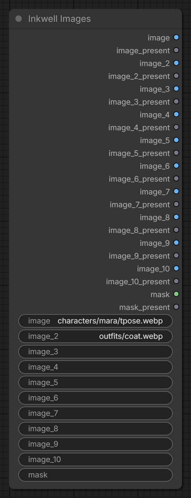
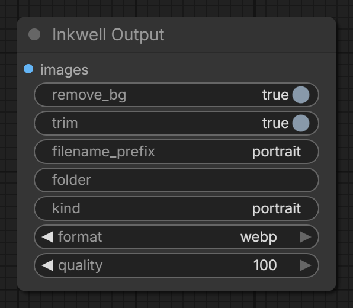
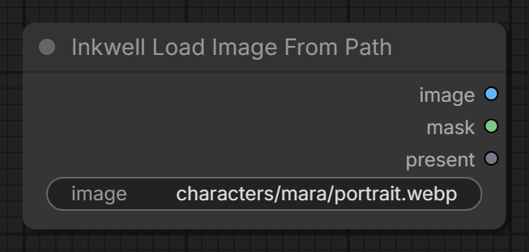
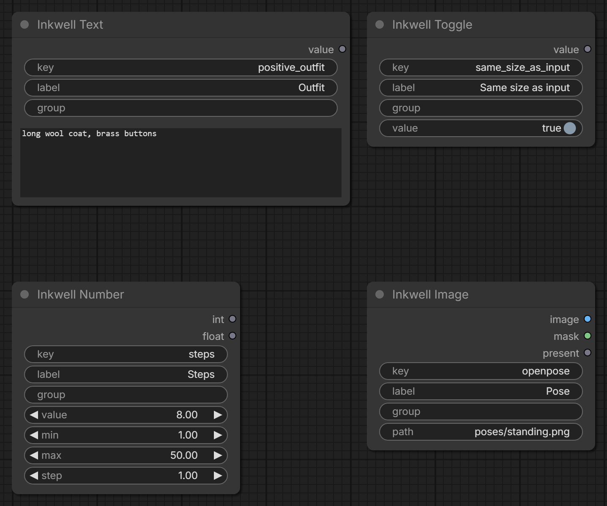

# Inkwell IO — ComfyUI nodes for apps that drive graphs

Nodes that give a ComfyUI graph a stable interface for a program to call through the
ComfyUI API. An app finds the nodes by `class_type` (and by a `key` widget on extras), never
by node title, so renaming a node in the ComfyUI UI cannot break a binding. The graph itself
says what it supports, so the app doesn't guess.

Written for [Inkwell](https://store.steampowered.com/app/1914280/), usable by any app or bot.
Category in the node menu: **Inkwell**.

*A plain text-to-image graph: the app fills **Inkwell Inputs** (prompt, negative, seed, size)
and reads the file **Inkwell Output** saves. Everything in between is ordinary ComfyUI.*

What you get:

- **Typed inputs** (prompt, negative, seed, frame size, …) on one node, plus one-value extras
  found by `key`.
- **Optional image slots that never crash.** An empty slot gives a 64×64 placeholder and
  `present = false`, instead of failing the prompt the way an empty `LoadImage` does.
- **One output node** that removes the background, trims to the subject, zeroes colour under
  clear alpha, and writes PNG or lossless WebP with the workflow metadata kept.
- **A path loader** (`InkwellLoadImageFromPath`) that opens PNG, WebP and JPEG from an absolute
  or input-relative path.

## Install

- **ComfyUI-Manager / Comfy Registry:** search for *Inkwell IO*.
- **By hand:** clone into `ComfyUI/custom_nodes/`, then
  `pip install -r requirements.txt` in ComfyUI's Python, and restart ComfyUI.

**Using the Inkwell app?** It installs and updates its own copy
(`custom_nodes/inkwell_io`). Don't install a second copy: two packs registering the same
classes conflict.

The only dependency, [transparent-background](https://github.com/plemeri/transparent-background)
(MIT), is imported only when `remove_bg` is on. Its InSPyReNet weights download on first use
under their own terms; they are not part of this pack.

## Building an app on it

A graph that has an `InkwellInputs` node is a **contract graph**. To drive one:

1. **Find nodes by class.** `InkwellInputs` (exactly 1), `InkwellImages` (0–1),
   `InkwellOutput` (1 or more), and any number of extras (`InkwellText`, `InkwellToggle`,
   `InkwellNumber`, `InkwellImage`), each identified by its `key` widget.
2. **Only wired fields count.** A field of `InkwellInputs` / `InkwellImages` is supported only
   when its output is linked to another node. A graph that never uses the seed has no seed
   field. The number of image slots is the highest wired slot.
3. **Write values into widgets,** then queue the graph with `POST /prompt` as usual. Read
   results from `ui.images` of each `InkwellOutput`, which has the same shape as `SaveImage`.
4. **Check `contract_version`.** It's on `InkwellInputs`; refuse a graph newer than the
   version your app understands (currently `1`).

Rules a valid contract graph follows:

- Exactly one `InkwellInputs`, with an `id`. At most one `InkwellImages`. At least one
  `InkwellOutput`.
- Width and height are wired together or not at all.
- Wired image slots are contiguous from `image` (no `image_3` without `image_2`).
- Every extra has a literal `key`, unique in the graph: a shared key below or a
  graph-specific `x_<name>`. It must not reuse an Inputs/Images field name.

Shared extra keys: `positive_outfit`, `description`, `emotions`, `regions` (text);
`same_size_as_input` (toggle); `steps`, `cfg`, `denoise`, `mask_blur` (number);
`openpose` (image).

### Output indices are append-only

Saved graphs link to outputs **by index**. A new field is appended; an existing index is never
reordered or reused. The order lives in `inkwell_core.py` (`INPUTS_OUTPUTS`, `IMAGES_OUTPUTS`).
Class names, widget names and output order are kept stable across versions; new widgets are
added as optional inputs so older saved graphs still validate.

## Nodes

### InkwellInputs — exactly one per graph

Metadata widgets (not outputs):

| Widget | Type | Notes |
|---|---|---|
| `contract_version` | INT, default 1 | Must not be newer than the app's version |
| `id` | STRING | Id the app knows this graph by. Required |
| `roles` | STRING | Comma list of what the graph is for, e.g. `location_image, tpose` |
| `description` | STRING, multiline | |

Frame-fallback widgets (not outputs): `preset` (`custom`, `21:9`, `16:9`, `3:2`, `4:3`, `1:1`,
`3:4`, `2:3`, `9:16`), `max_megapixels` (default 1.0), `multiple` (default 16), `max_side`
(default 2048).

Outputs:

| # | Field | Type |
|---|---|---|
| 0 | `prompt` | STRING |
| 1 | `positive_style` | STRING |
| 2 | `negative` | STRING |
| 3 | `seed` | INT (0 … 2⁶⁴−1, control after generate) |
| 4 | `width` | INT |
| 5 | `height` | INT |
| 6 | `refine_prompt` | BOOLEAN |
| 7 | `refine_instructions` | STRING |

**Frame rule.** The app picks the exact width × height. The node:

1. If `preset` is a ratio and width or height is 0, derives the size from the ratio and
   `max_megapixels`. This is the fallback for running the graph by hand.
2. If the longest side is over `max_side`, scales the size down to it, keeping the ratio.
3. Snaps each side to the nearest `multiple` (a half rounds up), without going past `max_side`.

With the defaults (16 / 2048), sizes such as 960×1280 and 1536×2048 pass through unchanged.
1768×2360 needs `multiple` 8 and `max_side` ≥ 2360 in the graph, because 1768 is not a multiple
of 16 and 2360 is over 2048. With the defaults it becomes 1536×2048.

### InkwellImages — at most one per graph

Widgets `image`, `image_2` … `image_10` and `mask` are path strings and may be empty.
A path can be absolute, relative to the ComfyUI input directory, or `name.png [input]`.
Only the paths that are set get loaded. A set path that does not exist is an error.

| # | Output | Type |
|---|---|---|
| 2(N−1) | slot N image (`image`, `image_2`, …) | IMAGE |
| 2(N−1)+1 | slot N `present` | BOOLEAN |
| 20 | `mask` | MASK |
| 21 | `mask_present` | BOOLEAN |

Full table: 0 `image`, 1 `image_present`, 2 `image_2`, 3 `image_2_present`, … 18 `image_10`,
19 `image_10_present`, 20 `mask`, 21 `mask_present`.

An empty slot gives a 64×64 black image (or an empty 64×64 mask) and `present = False`. Wire
`present` into a switch when the graph must behave differently without a reference.
A mask comes from the alpha channel when the file has one (1 − alpha, as in LoadImage).
Otherwise it comes from the luminance (white = masked).

### InkwellOutput — one or more per graph (output node)

| Input | Type | Notes |
|---|---|---|
| `images` | IMAGE | |
| `remove_bg` | BOOLEAN | Cuts out the background with transparent-background (InSPyReNet). The model loads only when this is on, and is then cached |
| `trim` | BOOLEAN | Crops to the alpha bounding box. A fully opaque or fully clear image is kept as is |
| `filename_prefix` | STRING | Default `Inkwell` |
| `folder` | STRING | Subfolder of the ComfyUI output directory. Absolute paths and `..` are refused |
| `kind` | STRING | What this output is (`scene`, `portrait`, …). Stored as `inkwell_kind` in the file metadata |
| `format` | `png` / `webp` (optional) | Default `png`, so a graph saved before this widget keeps writing PNG |
| `quality` | INT 1–100 (optional) | WebP only. `100` (default) is lossless; lower is lossy |

It writes RGBA with RGB set to 0 wherever alpha is 0, and returns `ui.images` in the same
shape as SaveImage: `{filename, subfolder, type: "output"}`.

- **PNG:** RGBA. The prompt / workflow metadata is in PNG text chunks.
- **WebP:** a fully opaque image drops its alpha channel (smaller, same pixels). An image wider or
  taller than 16383 px (libwebp's limit) is written as PNG instead. Metadata goes in EXIF the way
  ComfyUI's own WebP savers lay it out: `0x0110` = `prompt:<json>`, then `0x010F` downwards =
  `<key>:<json>` per `extra_pnginfo` entry (workflow, …), then `inkwell_kind:<kind>`.
  `inkwell_core.read_webp_metadata` reads it back.

Lossless WebP is usually 25–40% smaller than PNG with identical pixels. Keep originals lossless
if they may be edited again; make lossy copies for display.

Metadata is embedded unless ComfyUI runs with `--disable-metadata`.

### InkwellLoadImageFromPath — path loader

For graphs that find their inputs another way (for example by title) and only need to open a
file. Widget `image`; outputs IMAGE at 0, MASK at 1, `present` BOOLEAN at 2 — the same first
two outputs as the common third-party `LoadImageFromPath` (Ib_CustomNodes), so it can replace
it in a graph by changing the class name. The path is read like the other image widgets:
absolute, ComfyUI input-relative, or `x.png [input]`; PNG, WebP and JPEG all open. An empty path
gives the placeholder and `present = false`.

It is not a contract node: contract graphs use `InkwellImages` / `InkwellImage`.

### Extras — one value each

Every extra has the widgets `key`, `label` and `group` (the last two are for the app's form).

| Class | Value widgets | Outputs |
|---|---|---|
| `InkwellText` | `value` (multiline) | 0 STRING |
| `InkwellToggle` | `value` | 0 BOOLEAN |
| `InkwellNumber` | `value`, `min`, `max`, `step` | 0 INT (rounded), 1 FLOAT. Clamped to min…max unless min = max |
| `InkwellImage` | `path` | 0 IMAGE, 1 MASK, 2 `present` BOOLEAN |

## Example

`examples/minimal_t2i_api.json` is an API-format graph: Inputs → checkpoint / CLIP / KSampler
(placeholders) → Output. It is a valid contract graph.

## Layout and tests

- `inkwell_core.py`: pure logic (output tables, frame math, ratio presets, alpha cleanup,
  trim, image loading, save planning, WebP metadata). It imports neither torch nor comfy.
- `nodes.py`: the ComfyUI classes plus `NODE_CLASS_MAPPINGS` / `NODE_DISPLAY_NAME_MAPPINGS`.
- `tests/`: pytest for `inkwell_core` and the pack metadata. Run `python -m pytest tests`
  (needs numpy, Pillow and pytest; no GPU, torch or ComfyUI).

## Licence

MIT — see [LICENSE](LICENSE).
